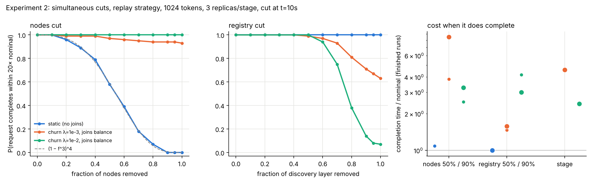
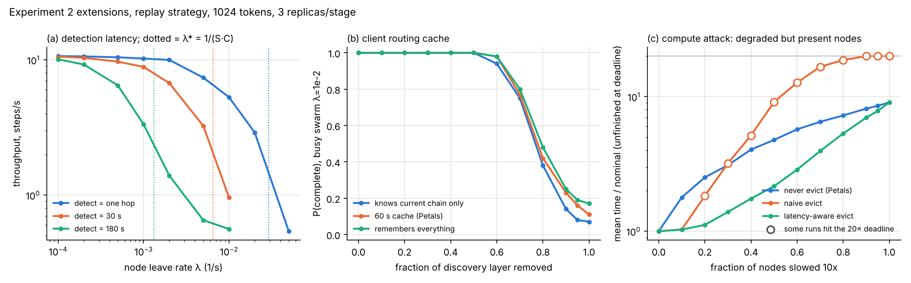
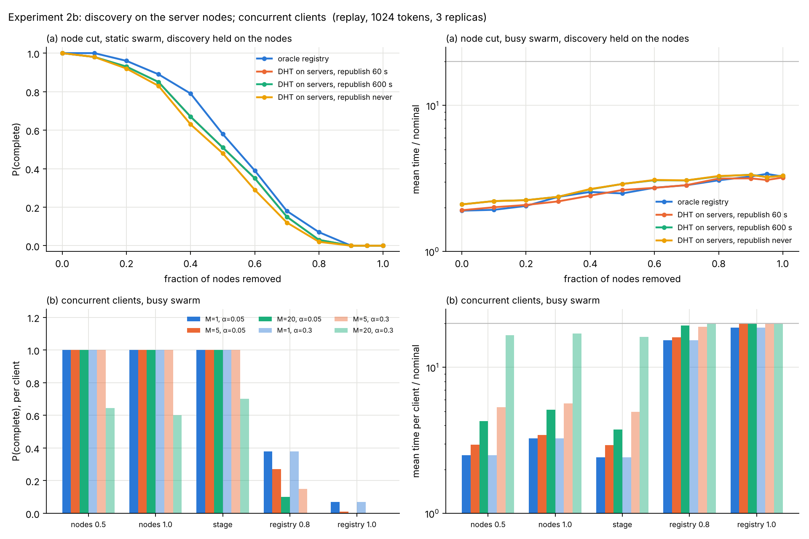

# distributed-inference-resilience

I created this repo for research and experiments on how a large model running split,
not just across many GPUs but across many machines, copes with nodes slowing down,
failing and leaving. The questions I wanted answered came from an essay I wrote,
*Anatomy of an Asymmetric Persistence Mechanism*
(https://naithanweigh.com/writing/asymmetric-persistence/). There I ask how one could
detect, contain and remove a model that runs as a swarm of pipeline stages on machines
that are not under one's control.

These simulations were done with two readers in mind. The operator, who runs a swarm
and wants it to keep serving as nodes leave. This is what systems like Petals do, and
Experiment 1 reproduces their fault-tolerance result in that framing. But we also look
from the side of the defender, who wants to stop a swarm from serving without operating
it, and asks for the smallest intervention that achieves that. Experiment 2 reads the
same simulation that way. Where the operator wants resilience, the defender is looking
at cost-to-contain, so one model answers both. Everything here is a simulation of a
cooperative system; no model is evading anyone.

## Experiment 1: churn simulation (`churnsim/`)

A discrete-event simulation of pipeline-parallel inference under node churn,
calibrated against the fault-tolerance experiment in the Petals paper (Borzunov et
al., arXiv:2312.08361, Table 1 and Appendix F).

No real weights. Tokens move hop by hop through a pipeline of stages; hops cost time and
can fail; three recovery strategies are compared:

| strategy    | on failure                                                            |
|-------------|-----------------------------------------------------------------------|
| `restart`   | caches lost, restart the whole generation from token 0                 |
| `cacheless` | no server cache; every step re-sends the prefix; redo only this step  |
| `replay`    | Petals Algorithm 1: reroute to a replacement, replay the client-side cache to rebuild its KV state, continue |

**Done when** the curve of throughput vs per-hop failure probability reproduces the
Petals shape: graceful degradation for `replay`, a cliff for `restart`, flat-but-slow
for `cacheless`, matching the paper's numbers around $p = 10^{-2}$.

## Layout

- `churnsim/model.py` – the simulator. Plain heap-based event loop (no SimPy),
  `Registry` for discovery, `Config` for the cost model, two failure knobs:
  - `hop_failure_p`: every send fails with probability p (what Table 1 varies)
  - `leave_rate` / `join_rate`: nodes leave and join as Poisson processes; a hop fails
    when its node has left; the client waits if a stage has no live replica. This is
    the version Experiment 2 (minimum simultaneous cut) builds on.
- `churnsim/petals.py` – Table 1 data and the derivation of the no-failure costs from
  the p = 0 columns (so hop time is not a free parameter).
- `churnsim/calibrate.py` – grid search for the free parameters: reconnect cost and
  replay cost per token.
- `churnsim/sweep.py` – throughput vs p for all strategies and both sequence lengths.
- `churnsim/churn.py` – the bridge from node leave rate $\lambda$ to an effective per-hop $p$.
- `churnsim/analytic.py` – closed-form model of all three strategies, checked against the sweep.
- `churnsim/restart_variants.py` – tests fixed / linear / quadratic restart-cost hypotheses.
- `NOTES.md` – derivations, the churn threshold $\lambda^* = 1/(S C)$, discrepancies, reading list.
- `tests/` – sanity checks; `python -m tests.test_model` (or `pytest`).

## Quick start

```
python3 -c "
from churnsim.petals import config_for
from churnsim.model import Strategy, run_many
cfg = config_for(Strategy.REPLAY, 128, 1e-2, reconnect_time=4.5, replay_per_token=0.008)
print(run_many(cfg, Strategy.REPLAY, seeds=200).mean_steps_per_s)   # paper: 3.38
"
```

Throughput is reported the way the paper reports it: tokens / mean elapsed time over
repeats. Averaging steps/s per run is biased upward for `restart`, whose completion
time is heavy-tailed.

## Reproducing

```
pip install -r requirements.txt
python -m churnsim.calibrate --seeds 200 --json out/calibration.json  # ~5 min
python -m churnsim.sweep --seeds 100                                   # ~2 min
python -m churnsim.churn --seeds 50                                    # ~1 min
python -m churnsim.analytic                                            # closed forms vs sweep
python -m tests.test_model
```

`out/calibration.json` holds the fitted parameters and the sim-vs-paper cells;
`out/sweep.csv` and `out/throughput_vs_failure.png` are the sweep;
`out/churn_to_p.csv` and `out/churn_to_p.png` are the churn bridge.

## Results (2026-10-19)

Base costs from the p = 0 columns (not fitted): restart hop 14.4 ms, Algorithm 1 hop
21.7 ms (the paper notes its implementation is less mature), both growing ~3 µs per
cached token; cache-less 42.7 ms + 0.465 ms per prefix token per hop.

Fitted failure costs (200 seeds per cell, no time budget): restart reconnect 3.0 s
(whole chain re-opened), replay reconnect 4.5 s plus 8 ms per replayed token for one
stage, cache-less ~0. Cells with fewer than 0.1 expected failures per run (128 tokens
at $p = 10^{-4}$) are excluded from the fit and shown as "-".

| strategy  | T    |      | p=0   | 1e-4  | 1e-3  | 1e-2  |
|-----------|------|------|-------|-------|-------|-------|
| restart   | 128  | sim  | 17.10 | -     | 10.23 | 0.17  |
|           |      | paper| 17.10 | 16.70 | 12.00 | 0.18  |
| restart   | 1024 | sim  | 15.50 | 12.08 | 0.91  | DNF   |
|           |      | paper| 15.50 | 11.80 | 0.48  | DNF   |
| cacheless | 128  | sim  | 3.44  | -     | 3.44  | 3.41  |
|           |      | paper| 3.44  | 3.44  | 3.44  | 3.44  |
| cacheless | 1024 | sim  | 0.89  | 0.89  | 0.89  | 0.88  |
|           |      | paper| 0.89  | 0.89  | 0.89  | 0.89  |
| replay    | 128  | sim  | 11.40 | -     | 9.35  | 3.48  |
|           |      | paper| 11.40 | 11.40 | 10.60 | 3.38  |
| replay    | 1024 | sim  | 10.70 | 10.31 | 7.76  | 2.24  |
|           |      | paper| 10.70 | 10.70 | 7.76  | 2.17  |

The shape is reproduced: graceful degradation for replay, a cliff for restart between
1e-3 and 1e-2, cache-less flat. Points on the sweep plot where some runs hit the
1-hour budget are censored at the budget and marked as upper bounds.


### From node churn to p

Petals varies p directly; the plan (and Experiment 2) talks about nodes leaving at a
rate λ. The two are the same experiment in different units. With 3 replicas per stage,
joins balancing leaves, and the replay strategy at 1024 tokens:


- Right panel: throughput under node churn (blue) matches the p-mode curve evaluated at
  the failure rate the client actually observed (grey) to within ~20% for $\lambda$ from $10^{-4}$
  to $2\times10^{-2}$. So anything measured against $p$ transfers to $\lambda$ and back. (The agreement is
  partly by construction: both modes charge the same reconnect cost. What it shows is
  that failure clustering and empty-stage waits, which only churn mode has, cost at
  most ~20% in this range.)
- Left panel: the obvious estimate $p \approx 1 - e^{-\lambda\,\tau_{\text{step}}}$ with $\tau_{\text{step}}$ the no-failure
  step time (dotted) undercounts by 2x and more once failures are frequent. The reason
  is that a reconnect on one stage leaves the other three stages' nodes exposed for
  that whole time too, so failures cluster. Using the realised mean step time,
  recoveries included (dashed), tracks the observed $p$ up to $\lambda \approx 10^{-2}$.
- Above $\lambda \approx 2\times10^{-2}$ throughput collapses. This is not mostly waiting for empty stages
  (waits are ~6% of elapsed time there, consistent with $P(\text{stage empty}) = e^{-3}$); it is
  a recovery cascade: each recovery takes C ≈ 9 s, during which the other three stages'
  nodes are exposed, and once $S \lambda C$ exceeds 1 each failure spawns more than one further
  failure on average. NOTES.md §2 derives the threshold $\lambda^* = 1/(S C) \approx 0.028$ /s. That
  regime is the one Experiment 2 is about: it is the "every node holding one stage" cut
  happening stochastically instead of deliberately.

### Known discrepancies, and notes to ourselves

- **restart, 1024 tokens, $p = 10^{-3}$: sim 0.91 vs paper 0.48.** The closed form agrees
  with the sim (0.90), so this is a mismatch between the paper and the model, not a
  simulation artefact. A restart cost growing with progress (linear or quadratic in
  tokens generated) was tested and does not fit all five restart cells; see NOTES.md §3.
  Left open; the paper's benchmark code for this table is not public.
- **replay at 128 tokens, $p = 10^{-3}$: sim 9.35 vs paper 10.60.** The paper's 128-token
  recoveries look cheaper than its 1024-token ones in a way a fixed reconnect + linear
  replay doesn't capture; a fit on the 1024-token cells alone would want a larger R.
  Also the paper's cells at $p = 10^{-4}$ are statistically meaningless (0.05 to 0.4
  expected failures per run) and were excluded from the fit.
- At 1024 tokens the two parts of a recovery are about equal: 4.5 s fixed (detect,
  DHT lookup, reroute, connect) and ~4 s replaying a 512-token prefix on one stage. At
  128 tokens the fixed part dominates. For Experiment 2 both are levers, and under real
  churn the fixed part grows by the detection timeout (NOTES.md §4).

## Experiment 2: how much do you have to remove? (`churnsim/cuts.py`)

The same simulation read as a defender. A cut is applied 10 s into a 1024-token
generation and we measure whether the request completes within 20× its no-failure
time. Three cut types (a random fraction of nodes; every replica of one stage; a
fraction of the discovery layer) under three swarm conditions (static; churn $\lambda = 10^{-3}$
with joins balancing leaves; churn $\lambda = 10^{-2}$).

```
python -m churnsim.cuts --seeds 100                 # out/cuts.csv, out/cuts.png
python -m churnsim.cuts --seeds 100 --replicas 10   # out/cuts_n10.*
```



- **Static swarm:** removal of a random fraction $f$ of nodes follows $(1 - f^n)^S$ exactly
  (dashed), so with 3 replicas the request survives $f = 0.3$ nine times in ten and
  $f = 0.8$ almost never; the targeted cut (all $n$ replicas of one stage) stops it with $n$
  nodes; and removing the entire discovery layer stops nothing, because a connected
  chain does not need discovery.
- **Churning swarm:** node cuts heal. Even removing every node leaves 93% (healthy) or
  100% (busy) of requests completing, after a wait of about $H_S / \text{join rate}$. The
  registry cut becomes the effective one: with all of discovery gone, completion
  requires the $S$ chain nodes to outlive the rest of the generation,
  $P = e^{-S \lambda t_{\text{remaining}}}$, which is 0.71 (healthy) and 0.03 (busy) in closed form
  against 0.63 and 0.07 measured, and is independent of the replica count. In the busy
  swarm removing 80% of the discovery layer stops more requests than removing 100% of
  the nodes.

Three omissions were then tested (`python -m churnsim.extensions --seeds 100`,
`out/extensions.png`): **detection latency** (Petals' 180 s timeout moves the cascade
threshold $\lambda^*$ from 0.029 to $1.3\times10^{-3}$ /s, as $1/(S C)$ predicts), a **client routing cache**
(softens the discovery cut by a few points; the claim above survives at every cache
setting), and a **compute attack** in which nodes are slowed 10× but stay registered:
its effect is set entirely by the client's routing, from near zero with a
latency-aware router and spare replicas, to the full slowdown with Petals' routing
(which only re-routes on failure), to a cascade with a naive slow-node evictor.



The two structural omissions were tested next (`python -m churnsim.exp2b`,
`out/exp2b.png`). **Discovery held on the server nodes** (Kademlia-style, k = 3)
changes nothing: a node cut reaches discovery only as $f^k$, so the oracle registry was
not hiding anything, and the registry cut above corresponds to an attack on the DHT
protocol (eclipse, Sybil, poisoning) rather than on its hosts. **Concurrent clients**
sharpen everything: with twenty clients and Petals-like batching, node cuts still heal
but at 3.8 to 5.1× nominal, and an 80% discovery cut drops per-client completion from
0.38 to 0.10, because load on the few discoverable replicas lengthens every generation
and churn breaks more chains. With weak batching, twenty clients lose 30 to 40% of
their requests to a plain node cut.



NOTES.md §5 has the derivations, the n = 10 comparison, and what remains unmodelled
(Byzantine outputs; the cost of the DHT attacks the registry cut stands for;
heavy-tailed lifetimes).

## Conclusion

The fault-tolerance result of the Petals paper was reproduced. It was found that with
reroute-and-replay the throughput degrades linearly in the per-hop failure probability.
Restart-from-scratch collapses once a generation expects about one failure, which
happens at $p \approx 1/(S T)$. The replay strategy matched the Petals paper within 5% at
$p = 10^{-2}$. However, one cell of the paper's restart baseline (1024 tokens, $p = 10^{-3}$)
reports 1.9x lower throughput than our model, and none of the cost models we tried
reproduce it. The paper's harness is not public, so this will stay open for now.

Seven results were found that went further than the paper.

1. Under node churn, the recovery time feeds back to the rate of failure. This leads to
   an increase in failure rate during the recovery time. Once $S \lambda C$ exceeds 1, this
   leads to a catastrophic cascade as failures will occur faster than they are
   repaired. The threshold $\lambda^* = 1/(S C)$ is set by $C$, the time to detect a failure, find
   a replacement and replay the prefix.
2. The cut that will lead to the stopping of the request is heavily dependent on
   whether the swarm self-heals. The target for a static swarm would be the complete
   stage of replicas ($n$ nodes); in this case the discovery layer can be removed
   entirely without effect, since the connected chain has no need for looking up new
   nodes as none ever leave. When the swarm is under churn with joins, the node cuts
   can heal within about $H_S / \text{join rate}$. Losing discovery leaves every in-flight
   request to survive on its current chain, $P = e^{-S \lambda t}$, where $t$ is the time
   remaining in the generation. This is not dependent on the number of replicas in
   existence. At $\lambda = 10^{-2}$, more requests get stopped by removing 80% of the discovery
   than by removing 100% of the nodes.
3. During simulation we also took into consideration the detection latency. On Petals,
   the default setting is 180 s for the timeout. Under this configuration $C$ goes from
   8.6 s to 189 s and $\lambda^*$ from 0.029 to $1.3\times10^{-3}$ /s, exactly where $1/(S C)$ puts it: that
   is where the sweep collapses. At $\lambda = 10^{-3}$ (mean lifetime 17 min) two-thirds of
   throughput is already gone. Under real churn this client-side constant is the
   largest term in $C$.
4. When providing a routing cache to the client the discovery cut did soften slightly,
   but only by a few points. When the discovery is taken down from a busy swarm the
   completion rate goes up from 0.07 to 0.11 (60 s cache, Petals) and only moves up to
   0.17 if the cache were perfect. This is due to the cache not being any use if the
   replica it is pointing to has already left. "80% of discovery stops more requests
   than 100% of nodes" holds at every cache setting.
5. In the compute attack we simulated what would happen if a specific node was slowed
   down. A node that is slowed but stays registered is never detected as failed. A node
   slowed 10x never fails, so a client that re-routes only on failure, which is what
   Petals does, keeps it for the whole session and pays the full slowdown (9.1x at
   f = 1). The obvious defence against this was an evictor for slow nodes, but a naive
   evictor (switch on any slow hop) is actually worse than no defence at all. When all
   the replicas within a stage are slow, it evicts on every hop, and this causes no run
   to finish once f ≥ 0.9. The best defence against the compute attack was a
   latency-aware evictor (switch only when a faster node is known). So even though the
   attack succeeds by attacking the computation, the reason it succeeds is due to the
   routing rules. This is not a test of nodes returning wrong outputs, which the model
   does not represent.
6. Distributing the discovery layer across the server nodes (DHT) makes it highly
   resilient. Since each entry is held on $k$ nodes, removing a fraction $f$ of the nodes
   destroys only a fraction $f^k$ of the entries; even an 80% node cut barely changes the
   outcome relative to the oracle registry. In the static swarm at f = 0.5 this moves
   0.58 → 0.48 and at f = 0.8 it moves 0.07 → 0.02. It has no effect on the busy
   swarm. Therefore, the "registry cut" found cheapest earlier cannot be achieved by
   simply removing host nodes. It corresponds to an attack on the DHT protocol itself
   (eclipse, Sybil, partitioning). The model gives the effect of such an attack, not
   its cost.
7. Concurrent client load acts as a third feedback loop, amplifying the damage of cuts.
   While node and stage cuts still heal under Petals-like batching, the recovery time
   penalty rises from 2.4 to 3.3x (one client) to 3.8 to 5.1x (twenty clients), because
   the first replacement node on an emptied stage receives every client that lost that
   stage. More critically, load makes a discovery cut far more effective. Fewer
   discoverable replicas force more clients onto each survivor, slowing generations
   and increasing the exposure time $t$ in $e^{-S \lambda t}$. At 80% of discovery removed, the
   per-client completion rate drops from 0.38 (one client) to 0.27 (five) to 0.10
   (twenty) with Petals-like batching, and to zero at twenty clients with weak
   batching.

So all results point to the same point of failure: the detection-and-discovery path is
thinner than the computation it coordinates, and of the cuts tested this was the
cheapest, as long as you can reach the DHT. Reaching it means attacking the DHT
protocol, not removing its hosts, and this work measures the effect of that attack,
not its cost. Not modelled: nodes returning wrong outputs, the cost of those DHT
attacks, and heavy-tailed node lifetimes.

## Where this applies

The calibration is Petals (2023), but the three recovery strategies are the three
options that exist in current systems, and the coordination path the results point at
is present in all of them.

- **Restart from scratch** is the default in today's datacenter serving stacks. LUMEN
  (June 2026) describes stop-and-restart, where an interrupted request is re-run from
  scratch on a surviving worker, as the default behaviour of KServe, TGI, Triton and
  vLLM on Kubernetes. That is the strategy that collapses once a generation expects
  about one failure, $p \approx 1/(S T)$.
- **Checkpointed KV state** is the alternative those systems are moving to: DéjàVu
  streams each request's KV cache to a neighbouring worker, LUMEN to a load-chosen
  holder. This is the same mechanism as Petals' reroute-and-replay with the cache held
  server-side instead of client-side, so the curve that is linear in $p$ and the cascade
  threshold $\lambda^* = 1/(S C)$ apply with a different $C$.
- **Detection** in LUMEN is a gateway health check with no stated latency, the same gap
  that Experiment 2's `detect_time` sweep is about.
- **Disaggregated prefill/decode** (vLLM's KV connectors, llm-d, Dynamo) adds a KV
  transfer between a prefill worker and a decode worker, which is one more
  coordination path of the kind this work finds to be the thin one. vLLM is adding
  fault tolerance for it as of late 2026. It is not in the model yet.
- **Decentralised and heterogeneous serving**, the essay's actual setting, keeps the
  Petals structure: Helix (ASPLOS 2025) and HexGen-2 (2025) place pipeline stages across
  heterogeneous machines; exo discovers peers with mDNS/libp2p and pipelines across
  consumer devices. Discovery plus pipeline plus some recovery policy is the shape of
  all of them.

What a modern stack changes is the numbers in $C$, not the structure. Measuring $C$ on
one of these stacks is scheduled as a next experiment.

References: [LUMEN, arXiv:2606.17787](https://arxiv.org/abs/2606.17787);
[vLLM PR #56430, KV-transfer fault tolerance](https://github.com/vllm-project/vllm/pull/56430);
[vLLM disaggregated serving guide, Sept 2026](https://vllm-project.github.io/2026/09/29/disaggregated-serving-guide.html);
[llm-d disaggregation operations](https://llm-d.ai/docs/dev/operations/disaggregation/vllm);
[Helix, arXiv:2406.01566](https://arxiv.org/abs/2406.01566);
[HexGen-2, arXiv:2502.07903](https://arxiv.org/abs/2502.07903);
[gLLM, arXiv:2504.14775](https://arxiv.org/abs/2504.14775);
[exo](https://github.com/exo-explore/exo).

## Status

- [x] simulator with three strategies and both failure models
- [x] Table 1 encoded, base costs derived
- [x] calibration run and sim-vs-paper table
- [x] sweep p from 0 to 5e-2 and plot (Appendix F shape)
- [x] map `leave_rate` / `join_rate` to an effective per-hop p (the bridge to Experiment 2)
- [x] tests
- [x] restart cost proportional to tokens generated before failure: tested linear and
      quadratic, neither fits all five cells (NOTES.md §3); left as fixed R, still open
- [ ] drop or heavily re-seed the $p S T \ll 1$ cells in the calibration loss
- [x] Experiment 2: cut sweep (nodes / stage / registry × static / healthy / busy)
- [x] Experiment 2 extensions: detection latency, client routing cache, degrade cut with three routing policies
- [x] Experiment 2b: DHT entries tied to server nodes; concurrent clients
- [ ] exponential retry backoff; heavy-tailed (Weibull) node lifetimes

## Acknowledgement

The simulation, analysis and the two code reviews were built with Claude (Anthropic)
as a pair-programming partner. The questions, the framing and the conclusions are mine.
