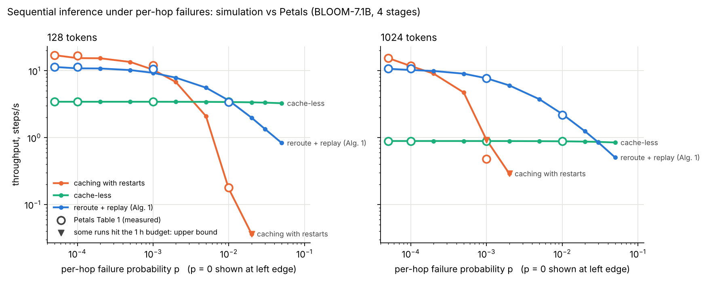
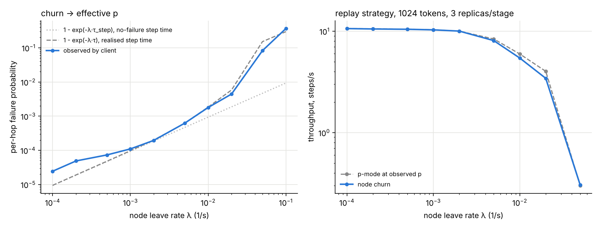

# research-sharding-churnsim

Experiment 1 of the distributed-inference resilience plan: a discrete-event simulation
of pipeline-parallel inference under node churn, calibrated against the fault-tolerance
experiment in the Petals paper (Borzunov et al., arXiv:2312.08361, Table 1 and
Appendix F).

No real weights. Tokens move hop by hop through a pipeline of stages; hops cost time and
can fail; three recovery strategies are compared:

| strategy    | on failure                                                            |
|-------------|-----------------------------------------------------------------------|
| `restart`   | caches lost, restart the whole generation from token 0                 |
| `cacheless` | no server cache; every step re-sends the prefix; redo only this step  |
| `replay`    | Petals Algorithm 1: reroute to a replacement, replay the client-side cache to rebuild its KV state, continue |

**Done when** the curve of throughput vs per-hop failure probability reproduces the
Petals shape: graceful degradation for `replay`, a cliff for `restart`, flat-but-slow
for `cacheless`, matching the paper's numbers around p = 1e-2.

## Layout

- `churnsim/model.py` – the simulator. Plain heap-based event loop (no SimPy),
  `Registry` for discovery, `Config` for the cost model, two failure knobs:
  - `hop_failure_p`: every send fails with probability p (what Table 1 varies)
  - `leave_rate` / `join_rate`: nodes leave and join as Poisson processes; a hop fails
    when its node has left; the client waits if a stage has no live replica. This is
    the version Experiment 2 (minimum simultaneous cut) builds on.
- `churnsim/petals.py` – Table 1 data and the derivation of the no-failure costs from
  the p = 0 columns (so hop time is not a free parameter).
- `churnsim/calibrate.py` – grid search for the free parameters: reconnect cost and
  replay cost per token.
- `churnsim/sweep.py` – throughput vs p for all strategies and both sequence lengths.
- `churnsim/churn.py` – the bridge from node leave rate λ to an effective per-hop p.
- `tests/` – sanity checks; `python -m tests.test_model` (or `pytest`).

## Quick start

```
python3 -c "
from churnsim.petals import config_for
from churnsim.model import Strategy, run_many
cfg = config_for(Strategy.REPLAY, 128, 1e-2, reconnect_time=2.5, replay_per_token=0.0089)
print(run_many(cfg, Strategy.REPLAY, seeds=50).mean_steps_per_s)   # paper: 3.38
"
```

Throughput is reported the way the paper reports it: tokens / mean elapsed time over
repeats. Averaging steps/s per run is biased upward for `restart`, whose completion
time is heavy-tailed.

## Reproducing

```
pip install -r requirements.txt
python -m churnsim.calibrate --seeds 30 --json out/calibration.json   # ~35 s
python -m churnsim.sweep --seeds 30                                    # ~25 s
python -m churnsim.churn --seeds 20                                    # ~10 s
python -m tests.test_model
```

`out/calibration.json` holds the fitted parameters and the sim-vs-paper cells;
`out/sweep.csv` and `out/throughput_vs_failure.png` are the sweep;
`out/churn_to_p.csv` and `out/churn_to_p.png` are the churn bridge.

## Results (2026-10-19)

Base costs from the p = 0 columns (not fitted): restart hop 14.4 ms, Algorithm 1 hop
21.7 ms (the paper notes its implementation is less mature), both growing ~3 µs per
cached token; cache-less 42.7 ms + 0.465 ms per prefix token per hop.

Fitted failure costs: restart reconnect 3.0 s (whole chain re-opened), replay
reconnect 6.0 s plus 5 ms per replayed token for one stage, cache-less ~0.

| strategy  | T    |      | p=0   | 1e-4  | 1e-3  | 1e-2  |
|-----------|------|------|-------|-------|-------|-------|
| restart   | 128  | sim  | 17.10 | 14.75 | 11.30 | 0.19  |
|           |      | paper| 17.10 | 16.70 | 12.00 | 0.18  |
| restart   | 1024 | sim  | 15.50 | 11.50 | 0.79  | DNF   |
|           |      | paper| 15.50 | 11.80 | 0.48  | DNF   |
| cacheless | 128  | sim  | 3.44  | 3.44  | 3.44  | 3.41  |
|           |      | paper| 3.44  | 3.44  | 3.44  | 3.44  |
| cacheless | 1024 | sim  | 0.89  | 0.89  | 0.89  | 0.88  |
|           |      | paper| 0.89  | 0.89  | 0.89  | 0.89  |
| replay    | 128  | sim  | 11.40 | 10.41 | 9.15  | 3.34  |
|           |      | paper| 11.40 | 11.40 | 10.60 | 3.38  |
| replay    | 1024 | sim  | 10.70 | 10.26 | 7.68  | 2.29  |
|           |      | paper| 10.70 | 10.70 | 7.76  | 2.17  |

The shape is reproduced: graceful degradation for replay, a cliff for restart between
1e-3 and 1e-2, cache-less flat. Points on the sweep plot where some of the 30 runs hit
the 1-hour budget are censored at the budget and marked as upper bounds.



### From node churn to p

Petals varies p directly; the plan (and Experiment 2) talks about nodes leaving at a
rate λ. The two are the same experiment in different units. With 3 replicas per stage,
joins balancing leaves, and the replay strategy at 1024 tokens:



- Right panel: throughput under node churn (blue) matches the p-mode curve evaluated at
  the failure rate the client actually observed (grey) to within ~15% across three
  decades of λ. So anything measured against p transfers to λ and back.
- Left panel: the obvious estimate p ≈ 1 − exp(−λ·τ_step) with τ_step the no-failure
  step time (dotted) undercounts by 2x and more once failures are frequent. The reason
  is that a 6 s reconnect on one stage leaves the other three stages' nodes exposed for
  those 6 s too, so failures cluster. Using the realised mean step time, recoveries
  included (dashed), tracks the observed p up to λ ≈ 2e-2.
- Above λ ≈ 2e-2 (mean node lifetime under a minute, against a 6 s reconnect plus a
  2.6 s replay of 512 tokens) replacements die during recovery, stages run empty and the
  client spends most of its time waiting for a replica to appear. That regime is the
  one Experiment 2 is about: it is the "every node holding one stage" cut happening
  stochastically instead of deliberately.

### Known discrepancies, and notes to ourselves

- **restart, 1024 tokens, p = 1e-3: sim 0.79 vs paper 0.48.** A fixed reconnect cost
  can't make this cell slower without making the 128-token cells too slow. The real
  restart baseline seems to pay something that grows with how far a failed attempt got
  (freeing/re-allocating caches on all four servers, or a re-prefill of the prompt
  each attempt). To revisit: add a restart cost proportional to tokens generated before
  the failure and see whether one extra parameter closes this cell without breaking the
  others.
- **replay at low p, 128 tokens: sim slightly pessimistic** (10.41 vs 11.40 at 1e-4,
  9.15 vs 10.60 at 1e-3). The fit is dominated by the 1e-2 cells; the paper's 128-token
  recoveries look cheaper than its 1024-token ones in a way a fixed reconnect + linear
  replay doesn't capture. Low priority.
- The fit wants a large fixed per-failure cost (6 s) and a small per-token replay cost.
  At p = 1e-2 recovery time is dominated by detect + reroute, not by replaying the
  prefix. That is the relevant number for Experiment 2: what a defender buys by
  slowing discovery is mostly in the fixed term.

## Status

- [x] simulator with three strategies and both failure models
- [x] Table 1 encoded, base costs derived
- [x] calibration run and sim-vs-paper table
- [x] sweep p from 0 to 5e-2 and plot (Appendix F shape)
- [x] map `leave_rate` / `join_rate` to an effective per-hop p (the bridge to Experiment 2)
- [x] tests
- [ ] optional: restart cost proportional to tokens generated before failure
